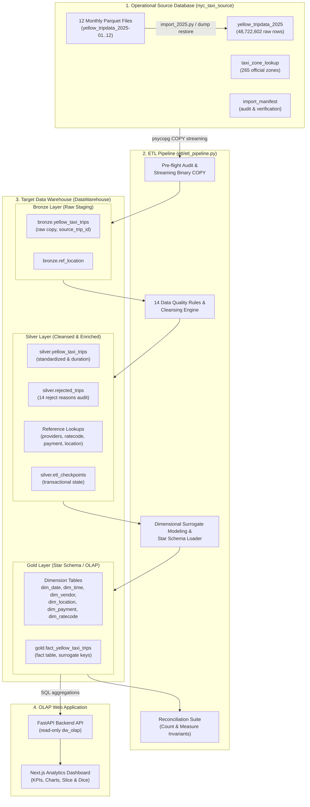

# STADVDB MCO1 — Query Processing in a Data Warehouse

### NYC Yellow Taxi Trip Data Warehouse & OLAP System (2025)

An end-to-end Data Warehouse and OLAP engineering project for **STADVDB Major Course Output 1 (MCO1)**. The system ingests, cleanses, transforms, and analyzes the complete **2025 NYC Yellow Taxi trip records** (over **48.7 million records** across 12 monthly Parquet files), organizing the data into a **Medallion Architecture (Bronze ➔ Silver ➔ Gold)** with a **Star Schema** for high-performance analytical querying and interactive dashboard visualization.

---

## 1. System Architecture

The project follows a modern analytical data engineering architecture:



---

## 2. Source Database (`nyc_taxi_source`)

The source database represents the operational data store containing raw records acquired directly from the NYC Taxi & Limousine Commission (TLC).

- **Database Name:** `nyc_taxi_source`
- **Total Records:** `48,722,602` trips spanning January 1, 2025 to December 31, 2025.
- **Source Files:** 12 monthly Parquet files (`data/yellow_tripdata_2025-01.parquet` to `2025-12.parquet`).

### Core Source Tables

| Table | Grain / Description | Record Count | Key Columns |
|---|---|---|---|
| `yellow_tripdata_2025` | One row per taxi trip record as published by NYC TLC. | `48,722,602` | `trip_id` (PK), `source_file`, timestamps, monetary fields |
| `taxi_zone_lookup` | Official TLC spatial mapping of taxi zones. | `265` | `locationid` (PK), `borough`, `zone`, `service_zone` |
| `import_manifest` | Ingestion metadata table verifying per-file row counts and load status. | `12` | `filename` (PK), `import_status`, `parquet_row_count` |

### Setting Up the Source Database

Choose one of two methods to set up `nyc_taxi_source` on your local PostgreSQL instance:

#### Method A: Restore from SQL Dump (Recommended & Fastest)
```bash
createdb -h localhost -U postgres nyc_taxi_source
gunzip -c data/source/dumps/nyc_taxi_source_20261016_231753.sql.gz | psql -h localhost -U postgres -d nyc_taxi_source
```
Verify the record count:
```sql
SELECT COUNT(*) FROM yellow_tripdata_2025;
-- Expected output: 48,722,602
```

#### Method B: Direct Parquet Importer
```bash
cd data/source
cp .env.example .env
# Fill in your PGPASSWORD in .env
pip install -r requirements.txt
python test_connection.py
python import_2025.py
```

### Source Profiling & Validation
- **Source Profile:** [`data/source/reports/dataset_profile.md`](data/source/reports/dataset_profile.md) (empirical distribution of fares, nulls, outliers, and timestamps).
- **Automated Validation Suite:** [`data/source/reports/validation_results.csv`](data/source/reports/validation_results.csv) (10/10 automated fidelity, row count, and null-preservation checks passing).

---

## 3. Data Warehouse (`DataWarehouse`)

The analytical repository is structured according to the **Medallion Architecture**, implemented in PostgreSQL under three distinct schemas: `bronze`, `silver`, and `gold`.

```text
DataWarehouse
├── bronze   # Raw staging layer preserving original source fidelity
├── silver   # Cleansed, standardized, and validated layer (plus rejected trips)
└── gold     # Dimensional model (Star Schema) optimized for OLAP analytics
```

### Warehouse Layers Overview

| Layer | Schemas & Tables | Purpose |
|---|---|---|
| **Bronze** | `bronze.yellow_taxi_trips`<br/>`bronze.ref_location` | Raw staging clone of source data. Renames `trip_id` to `source_trip_id` for lineage. No cleaning or transformation is applied. |
| **Silver** | `silver.yellow_taxi_trips`<br/>`silver.rejected_trips`<br/>`silver.ref_providers`<br/>`silver.ref_ratecode`<br/>`silver.ref_payment_type`<br/>`silver.ref_location`<br/>`silver.etl_checkpoints` | Cleaned and validated dataset. Every trip is either accepted into `silver.yellow_taxi_trips` or written to `silver.rejected_trips` with a specific reject reason. Numeric types cast to `NUMERIC(10,2)` / `SMALLINT`. Derived `trip_duration_minutes` added. |
| **Gold** | `gold.fact_yellow_taxi_trips`<br/>`gold.dim_date`<br/>`gold.dim_time`<br/>`gold.dim_vendor`<br/>`gold.dim_location`<br/>`gold.dim_payment`<br/>`gold.dim_ratecode` | Star Schema designed for OLAP querying. Fact table links to 6 dimension tables via surrogate integer keys. |

### Star Schema Dimensional Model (Gold Layer)


#### Fact Table: `gold.fact_yellow_taxi_trips`
- **Grain:** One row per accepted taxi trip.
- **Keys:** `trip_key` (PK, Identity), `bronze_trip_id` (Unique lineage key).
- **Date/Time Keys:** `pickup_date_key` (`YYYYMMDD`), `dropoff_date_key` (`YYYYMMDD`), `pickup_time_key` (`HHMMSS`), `dropoff_time_key` (`HHMMSS`).
- **Dimension Keys:** `vendor_key`, `pickup_location_key`, `dropoff_location_key`, `payment_key`, `ratecode_key`.
- **Trip Measures:** `passenger_count`, `trip_distance`, `trip_duration_minutes`.
- **Monetary Measures:** `fare_amount`, `extra`, `mta_tax`, `tip_amount`, `tolls_amount`, `improvement_surcharge`, `congestion_surcharge`, `airport_fee`, `cbd_congestion_fee`, `total_amount`.

#### Dimension Tables
- **`gold.dim_date`** (366 rows): 2025-01-01 to 2026-01-01. Attributes: `full_date`, `day`, `day_name`, `day_of_week` (ISO 1=Mon..7=Sun), `week_of_year`, `month`, `month_name`, `quarter`, `year`, `is_weekend`.
- **`gold.dim_time`** (86,400 rows): Second-level granularity (00:00:00 to 23:59:59). Attributes: `full_time`, `hour`, `minute`, `second`, `am_pm`, `time_period` (`Morning`, `Afternoon`, `Evening`, `Night`, `Late Night`).
- **`gold.dim_vendor`**: Taxi technology providers (Creative Mobile Technologies, Curb Mobility, VeriFone, etc.) plus `-1` Unknown sentinel.
- **`gold.dim_location`**: 265 NYC taxi zones (`location_id`, `borough`, `location_zone`, `service_zone`) plus `-1` Unknown sentinel.
- **`gold.dim_payment`**: Official payment descriptions using TLC standard codes (Credit card, Cash, No charge, Dispute, Unknown `5`, Voided trip).
- **`gold.dim_ratecode`**: Official rate codes using TLC standard codes (Standard rate, JFK, Newark, Nassau/Westchester, Negotiated fare, Group ride, Null/unknown `99`).

### Initializing the Data Warehouse DDL

Execute the DDL scripts in sequence against the `DataWarehouse` database:

```bash
# 1. Create the database
createdb -h localhost -U postgres DataWarehouse

# 2. Run schema & table definition scripts
psql -h localhost -U postgres -d DataWarehouse -f warehouse/sql/01_create_schemas.sql
psql -h localhost -U postgres -d DataWarehouse -f warehouse/sql/02_staging_tables.sql
psql -h localhost -U postgres -d DataWarehouse -f warehouse/sql/03_cleansed_tables.sql
psql -h localhost -U postgres -d DataWarehouse -f warehouse/sql/04_star_schema_tables.sql
```

---

## 4. ETL Pipeline (`etl/`)

The ETL pipeline ([`etl/etl_pipeline.py`](etl/etl_pipeline.py)) is a high-throughput, transactional Python pipeline built with `psycopg` and `SQLAlchemy`.

### Key Pipeline Stages
1. **Pre-flight Audit (`preflight`)**:
   - Asserts `import_manifest` has all 12 monthly Parquet files in `COMPLETED` state.
   - Validates that manifest row counts match `yellow_tripdata_2025`.
2. **Bronze Ingestion (`extract_load_bronze`)**:
   - Streams batches of 500,000 rows directly from `nyc_taxi_source` to `DataWarehouse` using PostgreSQL's binary streaming `COPY ... TO STDOUT` into `COPY ... FROM STDIN`.
   - Populates `bronze.ref_location` and `bronze.yellow_taxi_trips`.
3. **Silver Cleansing & Validation (`transform_silver`)**:
   - Applies the **14 Accept/Reject Validation Rules** (see below).
   - Accepted rows insert into `silver.yellow_taxi_trips`; rejected rows write to `silver.rejected_trips`.
   - Coalesces unknown ratecodes to official TLC `99`, unknown payments to official TLC `5`, and missing surcharge components to `0.00`.
   - Computes derived `trip_duration_minutes`.
   - Records state in `silver.etl_checkpoints` after each batch for resumability.
4. **Gold Dimensional Loading (`load_gold`)**:
   - Pre-populates calendar dates, time periods, and dimension lookups.
   - Validates that zero Silver trips have unresolvable category lookups.
   - Ingests fact records in 500,000-row chunks with foreign key surrogate mapping.
5. **Reconciliation Suite (`reconcile`)**:
   - Audits strict row conservation:
     $$\text{Source} = \text{Bronze} = \text{Silver} + \text{Rejected}$$
     $$\text{Silver} = \text{Fact}$$
   - Verifies zero overlap between accepted and rejected records.
   - Performs record-level equality join on measures (`total_amount`, `fare_amount`, `trip_distance`, `trip_duration_minutes`) between Silver and Gold.
   - Asserts aggregate sums match exactly.

### Silver Data Quality & Rejection Rules

| # | Rejection Reason | Condition | Justification |
|---|---|---|---|
| 1 | `missing_timestamp` | Pickup or dropoff timestamp is NULL | Cannot date or time the trip. |
| 2 | `pickup_outside_2025` | Pickup < `2025-01-01` or >= `2026-01-01` | Outside dataset scope (meter clock errors). |
| 3 | `nonpositive_duration` | Dropoff <= Pickup | Physically impossible trip duration. |
| 4 | `dropoff_out_of_range` | Dropoff >= `2026-01-02` | Dropoff beyond allowable date dimension boundary. |
| 5 | `excessive_duration` | Duration > 24 hours (`MAX_DURATION_HOURS`) | Implausible; meter left running. |
| 6 | `negative_distance` | `trip_distance < 0` | Invalid distance measurement. |
| 7 | `excessive_distance` | `trip_distance > 500` miles (`MAX_DISTANCE_MILES`) | Exceeds plausible single taxi trip distance. |
| 8 | `excessive_speed` | Implied average speed > 100 mph (`MAX_AVG_SPEED_MPH`) | Implausible speed for NYC taxi operations. |
| 9 | `invalid_passengers` | `passenger_count < 0` or `> 6` (`MAX_PASSENGERS`) | Exceeds legal Yellow Cab passenger capacity. |
| 10 | `missing_primary_amount` | `fare_amount IS NULL` or `total_amount IS NULL` | Essential financial measures missing. |
| 11 | `distance_out_of_range` | `trip_distance >= 99,999,999` | Prevents numeric column overflow. |
| 12 | `vendor_out_of_range` | `vendorid NOT BETWEEN -32768 AND 32767` | SMALLINT bounds enforcement. |
| 13 | `unmapped_vendor` | Vendor is NULL or not in `silver.ref_providers` | Unidentified technology provider. |
| 14 | `amount_out_of_range` | Any absolute charge field >= 99,999,999 | Column numeric precision protection. |

*Deliberately accepted as valid:* Negative fares/totals (official TLC refunds/disputes), zero-distance trips (minimum fare dropoffs), and passenger count of 0 (package/delivery or driver omitted count).

---

## 5. Getting Started & Setup

### Prerequisites
- Python 3.10+ (tested on Python 3.13)
- PostgreSQL 15+ running locally (default: `localhost:5432`)

### 1. Clone & Install Dependencies
```bash
git clone https://github.com/jiancpp/stadvdb-mco1.git
cd stadvdb-mco1
pip install -r requirements.txt
```

### 2. Configure Environment (`.env`)
Copy the environment template and set your credentials:
```bash
cp .env.example .env
```
Edit `.env` for your local or remote database:
```ini
# SOURCE DATABASE (nyc_taxi_source)
PGHOST=localhost
PGPORT=5432
PGUSER=postgres
PGPASSWORD=your_postgres_password
SOURCE_DB=nyc_taxi_source

# TARGET DATA WAREHOUSE (DataWarehouse)
WAREHOUSE_DB_HOST=localhost
WAREHOUSE_DB_PORT=5432
WAREHOUSE_DB_NAME=DataWarehouse
WAREHOUSE_DB_USER=postgres
WAREHOUSE_DB_PASSWORD=your_postgres_password

# CONNECTION ROLE
# Set to 1 for ETL execution; set to 0 for OLAP backend/dashboard
IS_ETL_DEVELOPER=1
```

### 3. Verify Database Connectivity
```bash
python connections.py
```
Expected output:
```text
[SUCCESS] Source Database
Database: nyc_taxi_source
User: postgres

[SUCCESS] Data Warehouse
Database: DataWarehouse
User: postgres
```

---

## 6. Running the ETL Pipeline

Run the pipeline from the project root directory:

### Full Pipeline Run (Bronze ➔ Silver ➔ Gold ➔ Reconcile)
Processes all 48.7M+ records through every layer:
```bash
python -m etl.etl_pipeline
```

### Running Individual Stages
```bash
# Stage 1: Bronze raw extraction
python -m etl.etl_pipeline bronze

# Stage 2: Silver cleansing & validation
python -m etl.etl_pipeline silver

# Stage 3: Gold dimensional loading
python -m etl.etl_pipeline gold

# Stage 4: End-to-end reconciliation & audit
python -m etl.etl_pipeline reconcile
```

### Fast Test Mode (Sample Subset)
Test the full pipeline end-to-end on a subset of rows using `--limit`:
```bash
# Run on the first 100,000 source rows
python -m etl.etl_pipeline --limit 100000

# Run on the first 1,000,000 source rows
python -m etl.etl_pipeline --limit 1000000
```

### Resuming & Full Reloading
- **Interrupted runs**: The pipeline automatically resumes from `silver.etl_checkpoints` and the max `source_trip_id`.
- **Full Reload**: To completely wipe the warehouse and re-run:
  ```sql
  TRUNCATE TABLE gold.fact_yellow_taxi_trips;
  TRUNCATE TABLE silver.yellow_taxi_trips CASCADE;
  TRUNCATE TABLE silver.rejected_trips;
  TRUNCATE TABLE bronze.yellow_taxi_trips;
  TRUNCATE TABLE silver.etl_checkpoints;
  ```
  Then execute `python -m etl.etl_pipeline`.

---

## 7. OLAP Web Application & Analytical Queries

The project includes an OLAP application tier to serve interactive multidimensional analysis:
- **Backend API (`backend/`)**: FastAPI service querying `gold` tables using the read-only `dw_olap` role.
- **Frontend Dashboard (`frontend/`)**: Next.js (React) application displaying KPIs, trend lines, borough distribution charts, and route analysis.

### Supported OLAP Operations
- **Roll-up**: Daily trip volume aggregated to monthly and quarterly views.
- **Drill-down**: Borough-level pickups expanded into specific taxi zones and peak hours.
- **Slice**: Filter trips by a single dimension (e.g., Credit Card payments only).
- **Dice**: Multi-criteria filtering (e.g., Manhattan pickups in Q2 2025 with trip distance > 5 miles).
- **Pivot**: Cross-tabulation of total charges across boroughs by month.

For complete query templates, KPI definitions, and endpoint specs, see [`etl/docs/olap_handoff.md`](etl/docs/olap_handoff.md).

---

## 8. Master Documentation Directory

| Component | Document | Description |
|---|---|---|
| **Source DB** | [`data/source/README.md`](data/source/README.md) | Ingestion pipeline architecture, Parquet batch streaming, and setup guide. |
| **Source DB** | [`data/source/docs/restore_instructions.md`](data/source/docs/restore_instructions.md) | Step-by-step restoration guide from the `.sql.gz` dump file. |
| **Source DB** | [`data/source/reports/dataset_profile.md`](data/source/reports/dataset_profile.md) | Detailed empirical statistical profile of the 2025 NYC Yellow Taxi dataset. |
| **Source DB** | [`data/source/reports/validation_results.csv`](data/source/reports/validation_results.csv) | 10-point test matrix validating record counts, schemas, and data fidelity. |
| **Warehouse** | [`warehouse/docs/data_dictionary.md`](warehouse/docs/data_dictionary.md) | Exhaustive data dictionary for Source, Bronze, Silver, and Gold tables. |
| **Warehouse** | [`warehouse/docs/Star_Schema_ERD.png`](warehouse/docs/Star_Schema_ERD.png) | Visual Entity Relationship Diagram for the Gold Star Schema. |
| **Warehouse** | [`warehouse/docs/etl_handoff.md`](warehouse/docs/etl_handoff.md) | Schema mappings, documented anomalies, and warehouse developer handoff notes. |
| **ETL** | [`etl/docs/README.md`](etl/docs/README.md) | Comprehensive operational guide for `etl_pipeline.py`, CLI flags, and tuning. |
| **ETL** | [`etl/docs/transformation_summary.md`](etl/docs/transformation_summary.md) | Summary of all data wrangling, cleansing, and accept/reject validation policies. |
| **OLAP** | [`etl/docs/olap_handoff.md`](etl/docs/olap_handoff.md) | Guide for backend and frontend teams: schemas, example queries, KPIs, and APIs. |
| **Academic** | [`data/source/docs/ai_usage_log.md`](data/source/docs/ai_usage_log.md) | Academic integrity and generative AI disclosure log. |
