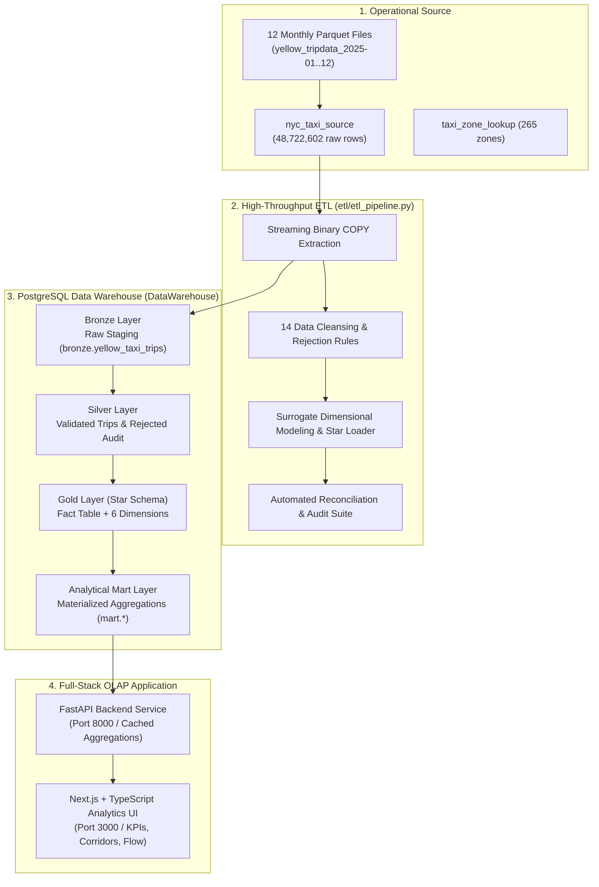

# NYC Yellow Taxi Data Warehouse & OLAP System (2025)

An end-to-end analytical data warehouse and interactive OLAP dashboard built for the **2025 NYC Yellow Taxi trip records** (over **48.7 million records**). The system implements a **Medallion Architecture (Bronze ➔ Silver ➔ Gold ➔ Mart)** with a dimensional **Star Schema** to deliver sub-second analytical querying and real-time interactive visualization.

---

## Architecture Overview



---

## Warehouse Layers & Dimensional Model

The warehouse is organized into four distinct layers in PostgreSQL:

| Layer | Schema | Role & Content |
|---|---|---|
| **Bronze** | `bronze` | High-fidelity raw ingestion copy of the source data. Lineage tracking via `source_trip_id`. |
| **Silver** | `silver` | Cleansed, standardized data applying 14 validation rules. Invalid records audited in `silver.rejected_trips`. |
| **Gold** | `gold` | Star Schema dimensional model with 1 fact table and 6 dimension tables linked via integer surrogate keys. |
| **Mart** | `mart` | Pre-aggregated materialized views indexed for interactive (< 20ms) multidimensional dashboard queries. |

### Star Schema ERD

The Gold layer implements a dimensional model optimized for analytical slice-and-dice queries:


- **Fact Table:** `gold.fact_yellow_taxi_trips` (Grain: 1 row per valid trip; foreign keys to all dimensions, trip measures, and itemized monetary charges).
- **Dimension Tables:** `gold.dim_date`, `gold.dim_time`, `gold.dim_location` (265 NYC taxi zones), `gold.dim_vendor`, `gold.dim_payment`, and `gold.dim_ratecode`.

---

## Full-Stack Analytics Dashboard

The user-facing dashboard delivers multidimensional OLAP operations across the entire 2025 dataset:

- **Executive KPI Cards:** Real-time revenue per occupied hour ($/hr), revenue per mile ($/mi), daily volume, and trend delta vs. baseline.
- **Where to Be (Zone Flow & Yield):** Interactive bubble scatter chart plotting net passenger flow vs. $/hr for every NYC taxi zone and borough.
- **Top Travel Corridors:** Origin-destination pairs ranked by daily trip volume with reciprocal return-flow analysis.
- **Trip Length Distribution:** Trip share and revenue yields across 5 standardized distance bands (Under 1 mi to 10+ mi).
- **Speed vs. Yield (Slow Windows):** Traffic congestion analysis identifying peak slowdown periods vs. driver revenue rates.
- **Seasonal Demand:** Monthly calendar normalization tracking seasonality shifts against annual averages.
- **OLAP Slicing & Dicing:** Seamless multi-criteria filtering by Date Range (`2025-01-01` to `2025-12-31`), Day Type (Weekday vs. Weekend), and Borough.

---

## Quickstart Guide

### Prerequisites
- **Python 3.10+**
- **Node.js 18+** & `npm`
- **PostgreSQL 15+** running locally (or accessible remotely)

---

### 1. Clone & Install Dependencies

```bash
git clone https://github.com/jiancpp/stadvdb-mco1.git
cd stadvdb-mco1

# Python dependencies
pip install -r requirements.txt

# Frontend dependencies
cd frontend && npm install && cd ..
```

---

### 2. Configure Environment (`.env`)

Copy the template and set your PostgreSQL credentials:

```bash
cp .env.example .env
```

Ensure the credentials in `.env` match your database instances:
```ini
# Source Database
PGHOST=localhost
PGPORT=5432
PGUSER=postgres
PGPASSWORD=your_postgres_password
SOURCE_DB=nyc_taxi_source

# Target Warehouse
WAREHOUSE_DB_HOST=localhost
WAREHOUSE_DB_PORT=5432
WAREHOUSE_DB_NAME=DataWarehouse
WAREHOUSE_DB_USER=postgres
WAREHOUSE_DB_PASSWORD=your_postgres_password

# 1 for ETL execution; 0 for read-only OLAP queries
IS_ETL_DEVELOPER=1
```

Verify your database connectivity:
```bash
python connections.py
```

---

### 3. Initialize Warehouse DDL & Marts

Run the SQL scripts in sequence to set up the schemas, tables, and materialized aggregation views:

```bash
createdb -h localhost -U postgres DataWarehouse

psql -h localhost -U postgres -d DataWarehouse -f warehouse/sql/01_create_schemas.sql
psql -h localhost -U postgres -d DataWarehouse -f warehouse/sql/02_staging_tables.sql
psql -h localhost -U postgres -d DataWarehouse -f warehouse/sql/03_cleansed_tables.sql
psql -h localhost -U postgres -d DataWarehouse -f warehouse/sql/04_star_schema_tables.sql
psql -h localhost -U postgres -d DataWarehouse -f warehouse/sql/05_mart_views.sql
```

---

### 4. Run the ETL Pipeline

Execute the pipeline from the project root:

```bash
# Fast test run on a 100,000-row sample
python -m etl.etl_pipeline --limit 100000

# Full pipeline run across all 48.7M records (Bronze -> Silver -> Gold -> Reconcile)
python -m etl.etl_pipeline
```

Individual stages can also be run independently:
```bash
python -m etl.etl_pipeline bronze     # Raw streaming ingestion
python -m etl.etl_pipeline silver     # Cleansing, reject audit & duration derivation
python -m etl.etl_pipeline gold       # Star schema surrogate dimensional loading
python -m etl.etl_pipeline reconcile  # Invariant & measure reconciliation
```

---

### 5. Launch the OLAP Web Application

Start the FastAPI backend and Next.js frontend in separate terminals:

```bash
# Terminal 1: Backend API (FastAPI)
cd backend
python -m uvicorn app.main:app --reload --port 8000
```

```bash
# Terminal 2: Frontend Dashboard (Next.js)
cd frontend
npm run dev
```

Open your browser at **`http://localhost:3000`** to interact with the dashboard.

---

## Testing & Benchmarks

The project includes automated test suites covering data integrity, analytical invariants, and query performance:

```bash
# 1. OLAP Dashboard & API Contract Test Suite (Formatted CLI)
python test_olap_dashboard.py

# 2. Latency & Caching Benchmark (Cold vs. Warm response times)
python test_olap_dashboard.py --benchmark

# 3. Run with pytest
pytest tests/test_olap_dashboard.py -v

# 4. Warehouse Query Benchmark (EXPLAIN ANALYZE on Gold & Marts)
python test_olap_performance.py

# 5. Live ETL Data Reconciliation Audit
python tests/validate_etl_data.py
```

---

## Repository Structure

```text
stadvdb-mco1/
├── backend/                  # FastAPI analytical REST API
│   └── app/
│       ├── main.py           # API app entrypoint & CORS middleware
│       └── routers/          # Opportunities & efficiency endpoints
├── data/                     # Raw Parquet files, manifests & data dictionaries
├── etl/                      # High-throughput Python ETL pipeline
│   ├── etl_pipeline.py       # Streaming COPY, cleansing rules, Star loader
│   └── docs/                 # Transformation policies & OLAP handoff specs
├── frontend/                 # Next.js (TypeScript) analytics dashboard
│   └── src/
│       ├── components/       # KPIs, Bubble Charts, Corridors, Heatmaps
│       └── lib/api.ts        # Typed API client hooks
├── tests/                    # Automated testing suite
│   ├── test_olap_dashboard.py# Endpoints, invariants, slicing/dicing tests
│   ├── test_etl_pipeline.py  # Pipeline stage mock unit tests
│   └── validate_etl_data.py  # Warehouse row & financial measure audit
├── warehouse/                # Database DDL & analytical scripts
│   ├── sql/                  # Schemas (01), Bronze (02), Silver (03), Gold (04), Marts (05)
│   └── docs/                 # Star schema ERD & data dictionaries
├── test_olap_dashboard.py    # Root runner for dashboard verification
├── test_olap_performance.py  # Root runner for EXPLAIN ANALYZE benchmarks
├── config.py                 # Central environment configuration
└── connections.py            # Database connection verification utility
```

---

## Detailed Documentation Directory

For deeper technical specifications, refer to the documentation guides:

| Component | Document | Focus |
|---|---|---|
| **Warehouse Schema** | [`warehouse/docs/data_dictionary.md`](warehouse/docs/data_dictionary.md) | Exhaustive data dictionary for all Bronze, Silver, and Gold tables. |
| **Star Schema ERD** | [`warehouse/docs/Star_Schema_ERD.png`](warehouse/docs/Star_Schema_ERD.png) | Visual Entity-Relationship diagram for the dimensional model. |
| **ETL Operations** | [`etl/docs/README.md`](etl/docs/README.md) | Detailed operational guide, tuning parameters, and checkpointing. |
| **Cleansing Rules** | [`etl/docs/transformation_summary.md`](etl/docs/transformation_summary.md) | Detailed specifications for the 14 data quality validation rules. |
| **OLAP Handoff** | [`etl/docs/olap_handoff.md`](etl/docs/olap_handoff.md) | Query templates, KPI definitions, and aggregation mart designs. |
