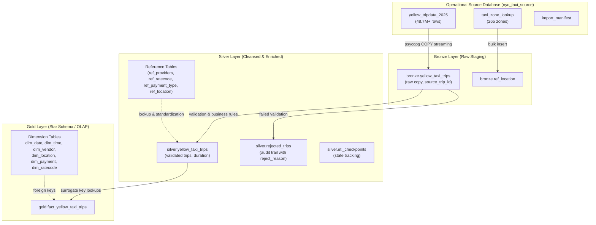

# NYC Yellow Taxi ETL Pipeline

An automated, high-throughput, transactional ETL pipeline extracting 2025 NYC Yellow Taxi trip records from the operational source database (`nyc_taxi_source`), transforming and cleansing records across a Medallion Architecture, and loading them into a Star Schema Data Warehouse (`DataWarehouse`) for OLAP analytics.

---

## Architecture Overview

The pipeline implements a three-tier **Medallion Architecture** (Bronze ➔ Silver ➔ Gold) with checkpoint-based resumption, strict data quality enforcement, and end-to-end reconciliation:



---

## Layer Breakdown

### 1. Pre-Flight Audit
Before extracting data, the pipeline executes `preflight()` to verify the source database state:
- Validates `import_manifest` has all 12 monthly Parquet files in `COMPLETED` status.
- Confirms `imported_row_count == parquet_row_count` with no missing or corrupted batches.
- Asserts `SUM(imported_row_count) == COUNT(*)` from `yellow_tripdata_2025`.

### 2. Bronze Layer (Raw Ingestion)
- **Tables**: `bronze.yellow_taxi_trips`, `bronze.ref_location`
- **Mechanism**: High-speed, streaming binary COPY via PostgreSQL `COPY ... TO STDOUT` piped directly into `COPY ... FROM STDIN`.
- **Batch Size**: 500,000 records per transaction chunk.
- **Data Lineage**: Aliases source `trip_id` to `source_trip_id` and preserves `source_file` and `imported_at`.
- **Resumability**: Queries `COALESCE(MAX(source_trip_id), 0)` and resumes from the last ingested trip ID.

### 3. Silver Layer (Cleansing, Validation, & Enrichment)
- **Tables**: `silver.yellow_taxi_trips`, `silver.rejected_trips`, `silver.ref_location`, `silver.etl_checkpoints`
- **Checkpointing**: Tracks progress transactionally in `silver.etl_checkpoints`. Interrupted runs resume from `last_trip_id`.
- **Accept/Reject Model**: Every single Bronze trip is either:
  1. Accepted into `silver.yellow_taxi_trips`, or
  2. Logged into `silver.rejected_trips` with the first matching rejection reason and source file for auditability.
- **Reference Integrity**: Requires `silver.ref_providers`, `silver.ref_ratecode` (with official unknown code `99`), and `silver.ref_payment_type` (with official unknown code `5`) to be seeded. Upserts `silver.ref_location` from `bronze.ref_location`.

#### Data Quality & Rejection Rules

| Rejection Code | Validation Rule / Business Logic |
|---|---|
| `missing_timestamp` | Pickup or dropoff timestamp is `NULL`. |
| `pickup_outside_2025` | `tpep_pickup_datetime < '2025-01-01'` or `>= '2026-01-01'`. |
| `nonpositive_duration` | `tpep_dropoff_datetime <= tpep_pickup_datetime` (zero or backwards trip time). |
| `dropoff_out_of_range` | `tpep_dropoff_datetime >= '2026-01-02'` (outside allowed trip boundary). |
| `excessive_duration` | Trip duration exceeds configurable `MAX_DURATION_HOURS` (default: 24 hours). |
| `negative_distance` | `trip_distance < 0`. |
| `excessive_distance` | `trip_distance > MAX_DISTANCE_MILES` (default: 500 miles). |
| `excessive_speed` | Implied average speed exceeds `MAX_AVG_SPEED_MPH` (default: 100 mph). |
| `invalid_passengers` | `passenger_count < 0` or `passenger_count > MAX_PASSENGERS` (default: 6). |
| `missing_primary_amount` | `fare_amount IS NULL` or `total_amount IS NULL`. |
| `distance_out_of_range` | `trip_distance >= 99,999,999` (numeric overflow prevention). |
| `vendor_out_of_range` | `vendorid NOT BETWEEN -32768 AND 32767` (smallint bound check). |
| `unmapped_vendor` | `vendorid` does not match any known provider in `silver.ref_providers`. |
| `amount_out_of_range` | Any monetary charge field has an absolute value `>= 99,999,999`. |

#### Standardization & Coercion Rules
- **Negative Fares & Surcharges**: Kept and accepted if other fields are valid (reflects authentic TLC refunds, chargebacks, and fare dispute adjustments).
- **Missing Categorical Codes**:
  - Missing or unknown `ratecodeid` is coalesced to TLC official Unknown code `99`.
  - Missing or unknown `payment_type` is coalesced to TLC official Unknown code `5`.
  - Unmapped pickup/dropoff locations remain `NULL` in Silver and resolve to sentinel key `-1` in Gold.
- **Missing Surcharge Components**: Null optional surcharges (`extra`, `mta_tax`, `tip_amount`, `tolls_amount`, `improvement_surcharge`, `congestion_surcharge`, `airport_fee`, `cbd_congestion_fee`) are coalesced to `0.00`.
- **Derived Measures**: `trip_duration_minutes` is computed as `EXTRACT(EPOCH FROM (dropoff - pickup)) / 60.0`, rounded to 2 decimal places.

### 4. Gold Layer (Dimensional Modeling & Star Schema)
- **Dimensions Loaded**:
  - `gold.dim_date`: Pre-generated calendar dates covering all of 2025 (+ 2026-01-01) with calendar attributes (`day_name`, `is_weekend`, `quarter`, etc.).
  - `gold.dim_time`: Pre-generated 86,400 second granularity with time-of-day buckets (`Morning`, `Afternoon`, `Evening`, `Night`, `Late Night`) and `AM`/`PM`.
  - `gold.dim_vendor`: Populated from `silver.ref_providers` with `-1` Unknown sentinel.
  - `gold.dim_location`: Populated from `silver.ref_location` with `-1` Unknown sentinel.
  - `gold.dim_payment`: Standardized payment types with TLC official Unknown code `5`.
  - `gold.dim_ratecode`: Standardized rate codes with TLC official Unknown code `99`.
- **Fact Table**: `gold.fact_yellow_taxi_trips` loaded in 500,000-row chunks using transactional checkpointing (`silver.etl_checkpoints`).
- **Validation**:
  - Automatically migrates legacy `-1` ratecode/payment keys to official TLC codes if present.
  - Pre-flight foreign key validation asserts 0 missing payment or ratecode surrogate keys prior to fact insertion.

### 5. Automated Reconciliation
The reconciliation phase verifies data consistency across all layers:
- **Conservation Equations**:
  $$\text{Count}(\text{Source}) = \text{Count}(\text{Bronze})$$
  $$\text{Count}(\text{Bronze}) = \text{Count}(\text{Silver}) + \text{Count}(\text{Rejected})$$
  $$\text{Count}(\text{Silver}) = \text{Count}(\text{Fact})$$
- **Integrity Invariants**:
  - Zero overlap between accepted Silver trips and rejected trips.
  - Zero unclassified Bronze rows.
  - Zero Silver rows missing a Gold fact record.
  - Zero NULL payment or ratecode keys in the fact table.
  - Zero record-level measure discrepancies between Silver and Gold (`total_amount`, `fare_amount`, `trip_distance`, `trip_duration_minutes`).
  - Total aggregate sums (`SUM(total_amount)`, `SUM(trip_distance)`) exactly match between Silver and Gold.
  - Detailed breakdown of rejections by reason printed to logs.

---

## Directory Structure

```text
etl/
├── README.md               # Pipeline documentation and operational guide
└── etl_pipeline.py         # Main ETL pipeline script (Bronze, Silver, Gold, Reconcile)
```

Configuration and connection files in project root used by ETL:
```text
stadvdb-mco1/
├── config.py               # Environment configuration loader
├── connections.py          # SQLAlchemy engine pool and connectivity checks
├── requirements.txt        # Python package dependencies
├── .env.example            # Environment variable template
└── warehouse/sql/          # Data warehouse DDL and schema scripts
    ├── 01_create_schemas.sql
    ├── 02_staging_tables.sql
    ├── 03_cleansed_tables.sql
    └── 04_star_schema_tables.sql
```

---

## Prerequisites & Setup

### 1. Environment & Dependencies
Ensure Python 3.10+ and a running PostgreSQL instance (PostgreSQL 15+ recommended) are available.

Install dependencies from the repository root:
```bash
pip install -r requirements.txt
```

### 2. Configure Environment (`.env`)
Create a `.env` file in the project root (copied from `.env.example`):
```ini
# SOURCE DATABASE
PGHOST=localhost
PGPORT=5432
PGUSER=postgres
PGPASSWORD=your_source_password
SOURCE_DB=nyc_taxi_source

# TARGET DATA WAREHOUSE
WAREHOUSE_DB_HOST=localhost
WAREHOUSE_DB_PORT=5432
WAREHOUSE_DB_NAME=DataWarehouse
WAREHOUSE_DB_USER=postgres
WAREHOUSE_DB_PASSWORD=your_warehouse_password

# ETL PERMISSION FLAG (must be set to 1)
IS_ETL_DEVELOPER=1
```

### 3. Initialize Warehouse Schemas
Before running the ETL pipeline, ensure the target database and all schema objects are initialized:

```bash
# 1. Create DataWarehouse database if not already created
createdb -h localhost -U postgres DataWarehouse

# 2. Run DDL scripts sequentially
psql -h localhost -U postgres -d DataWarehouse -f warehouse/sql/01_create_schemas.sql
psql -h localhost -U postgres -d DataWarehouse -f warehouse/sql/02_staging_tables.sql
psql -h localhost -U postgres -d DataWarehouse -f warehouse/sql/03_cleansed_tables.sql
psql -h localhost -U postgres -d DataWarehouse -f warehouse/sql/04_star_schema_tables.sql
```

### 4. Test Connections
Verify connectivity to both the source and target database instances:
```bash
python connections.py
```
Expected output:
```text
[SUCCESS] Source Database
Database: nyc_taxi_source
User: postgres

[SUCCESS] Data Warehouse
Database: DataWarehouse
User: postgres
```

---

## Running the Pipeline

Execute the pipeline as a Python module from the project root directory:

### Full Pipeline Run (Bronze ➔ Silver ➔ Gold ➔ Reconcile)
Runs the entire extraction, transformation, dimensional loading, and reconciliation workflow across all 48.7M+ records:
```bash
python -m etl.etl_pipeline
```

### Running Individual Stages
Each stage can be executed independently:

```bash
# Extract from source and load into bronze staging
python -m etl.etl_pipeline bronze

# Transform, validate, and cleanse bronze data into silver and rejected tables
python -m etl.etl_pipeline silver

# Seed dimensions and load fact table
python -m etl.etl_pipeline gold

# Execute reconciliation and integrity tests
python -m etl.etl_pipeline reconcile
```

### Testing with a Row Limit
To test pipeline logic quickly on a subset of data (e.g., first 100,000 or 1,000,000 rows):
```bash
# Test with first 100,000 records
python -m etl.etl_pipeline --limit 100000

# Test with first 1,000,000 records
python -m etl.etl_pipeline --limit 1000000
```
> [!NOTE]
> The `--limit` flag dynamically resolves the actual `trip_id` of the $N$-th row in the source database, ensuring exact boundary capping across Bronze extraction and Reconciliation checks.

---

## Checkpointing & Resumption

The pipeline includes built-in transactional fault tolerance:
1. **Bronze**: Resumes from `COALESCE(MAX(source_trip_id), 0)`.
2. **Silver**: Manages state in table `silver.etl_checkpoints (stage, last_trip_id, updated_at)`.
3. **Gold**: Resumes fact insertion from the recorded `gold` checkpoint `last_trip_id`.
4. **Idempotency**: All batch inserts utilize `ON CONFLICT (trip_id) DO NOTHING` or `ON CONFLICT DO UPDATE`, ensuring safe re-execution without duplicate entries.

### Resetting for a Fresh Reload
If you wish to wipe the warehouse tables and perform a completely fresh reload:
```sql
-- In DataWarehouse:
TRUNCATE TABLE gold.fact_yellow_taxi_trips;
TRUNCATE TABLE silver.yellow_taxi_trips CASCADE;
TRUNCATE TABLE silver.rejected_trips;
TRUNCATE TABLE bronze.yellow_taxi_trips;
TRUNCATE TABLE silver.etl_checkpoints;
```
Then rerun:
```bash
python -m etl.etl_pipeline
```

---

## Configurable Thresholds

Validity limits in [`etl/etl_pipeline.py`](etl_pipeline.py) can be adjusted to meet operational requirements:

| Parameter | Default | Description |
|---|---|---|
| `BATCH_SIZE` | `500_000` | Number of records processed per transaction chunk. |
| `MAX_DURATION_HOURS` | `24` | Maximum allowable trip duration in hours. |
| `MAX_DISTANCE_MILES` | `500` | Maximum plausible trip distance in miles. |
| `MAX_AVG_SPEED_MPH` | `100` | Maximum plausible average speed in miles per hour. |
| `MAX_PASSENGERS` | `6` | Maximum legal passenger count for a standard NYC Yellow Cab. |
| `VALID_FROM` | `2025-01-01` | Earliest valid pickup date for the 2025 dataset. |
| `VALID_TO_PICKUP` | `2026-01-01` | Exclusive upper bound for 2025 pickup dates. |
| `VALID_TO_DROPOFF` | `2026-01-02` | Exclusive upper bound for dropoff dates (allows overnight trips). |
