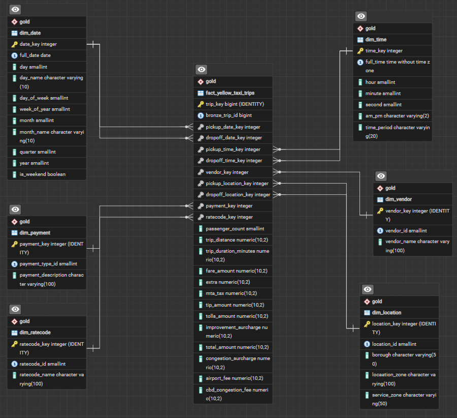

# ETL Handoff Checklist (to DataWarehouse)

## NYC Yellow Taxi Data Warehouse (2025)

**Source database:** `nyc_taxi_source`
**Target database:** `DataWarehouse`
**Dataset:** January–December 2025 NYC Yellow Taxi Trip Records

---

## 0. Setup

You may initialize the Data Warehouse locally for testing by running the SQL scripts in `warehouse/sql` sequentially.

Alternatively, you may access the initialized DataWarehouse through the shared ngrok tunnel. PostgreSQL must be running on the warehouse developer's machine.

### Shared Data Warehouse connection

| Setting  | Value                                |
|----------|--------------------------------------|
| Host     | `0.tcp.ap.ngrok.io`                  |
| Port     | `16989`                              |
| Database | `DataWarehouse`                      |
| Username | `dw_olap`                            |
| Password | Ask the Data Warehouse developer     |

> **Note:** Keep credentials private. Do not commit passwords or connection strings containing passwords to the repository.

### Install dependencies

```bash
pip install -r requirements.txt
```

Then, set up your environment variables following the `.env.example` provided in the `warehouse/` module. This includes all variables needed to connect to the source database and the data warehouse.

To validate your connection to the shared Data Warehouse, run this from the `warehouse/` module:

```bash
python connections.py
```

---

## 1. Understand the Data Warehouse

The warehouse has three layers. Your task is to move data through each layer.

| Layer  | What you need to do                                       |
|--------|-----------------------------------------------------------|
| Bronze | Copy raw data from the source database                    |
| Silver | Clean, standardize, and enrich the data                   |
| Gold   | Organize the data into fact and dimension tables for OLAP |

### Overall workflow

```text
SOURCE DATABASE
      |
      v
BRONZE
Raw data copied from source
      |
      v
SILVER
Cleaned and enriched data
      |
      v
GOLD
Fact table + Dimension tables
      |
      v
OLAP WEB APPLICATION
```

### ERD for Star Schema



---

## 2. OLAP Integration

Once Gold is populated:

- [ ] Confirm the backend can connect to PostgreSQL.
- [ ] Use read-only database access for OLAP.
- [ ] Create a frontend that accesses data through the backend API, not directly through PostgreSQL.

The warehouse should support questions such as:

1. What is the monthly trip volume and total trip charges?
2. Which boroughs have the most pickups?
3. What are the busiest hours?
4. Which pickup-to-dropoff routes are most common?
5. Which providers have the highest trip volume?
6. What payment methods are most frequently used?
7. How do average fares differ by rate code?

---

## 3. Backend Development: Query APIs

**Goal:** Develop backend endpoints that retrieve, filter, group, and aggregate Gold data for the frontend. The backend is the only application component that should connect directly to PostgreSQL.

### A. Database Integration

- [ ] Configure PostgreSQL connection using environment variables.
- [ ] Use the `olap_reader` account.
- [ ] Restrict queries to the Gold schema.
- [ ] Use parameterized SQL queries or a safe query builder.
- [ ] Implement connection pooling where appropriate.
- [ ] Handle database connection failures and timeouts.
- [ ] Avoid exposing database credentials and internal SQL errors.

### B. Recommended API Endpoints

The following are suggested endpoints. Final routes and response structures should be agreed upon by the team.

| Endpoint                                  | Purpose                                           |
|-------------------------------------------|---------------------------------------------------|
| `GET /api/overview/kpis`                  | Retrieve dashboard summary metrics                |
| `GET /api/analytics/trips-over-time`      | Retrieve trip volume over time                    |
| `GET /api/analytics/revenue-over-time`    | Retrieve total charges over time                  |
| `GET /api/analytics/trips-by-borough`     | Retrieve trip counts by borough                   |
| `GET /api/analytics/trips-by-hour`        | Retrieve trip counts by hour                      |
| `GET /api/analytics/top-routes`           | Retrieve the most common pickup-to-dropoff routes |
| `GET /api/analytics/trips-by-vendor`      | Retrieve trip counts by taxi provider             |
| `GET /api/analytics/payment-distribution` | Retrieve payment method distribution              |
| `GET /api/analytics/fares-by-ratecode`    | Retrieve fare statistics by rate code             |
| `GET /api/filters`                        | Retrieve available filter options                 |

### C. API Query Requirements

- [ ] Query only Gold tables or approved Gold views.
- [ ] Join fact and dimension tables using their established relationships.
- [ ] Support date-range filtering.
- [ ] Support borough and location filtering.
- [ ] Support vendor filtering.
- [ ] Support payment method filtering.
- [ ] Support rate-code filtering.
- [ ] Support grouping by day, month, quarter, and year where applicable.
- [ ] Return aggregated results instead of unnecessary raw records.
- [ ] Validate query parameters.
- [ ] Implement pagination for endpoints returning large lists.
- [ ] Use consistent JSON response structures.
- [ ] Provide meaningful error responses.
- [ ] Document API routes, parameters, and response formats.

### D. Suggested Dashboard KPIs

Agree on metric definitions before implementation.

| KPI                     | Suggested Calculation          |
|-------------------------|--------------------------------|
| Total Trips             | `COUNT` of fact records        |
| Total Revenue / Charges | `SUM` of `total_amount`        |
| Average Fare            | `AVG` of `fare_amount`         |
| Average Trip Distance   | `AVG` of `trip_distance`       |
| Average Trip Duration   | `AVG` of trip duration (minutes) |
| Average Passengers      | `AVG` of passenger count       |

> **Be explicit about monetary measures.** `fare_amount` and `total_amount` are not interchangeable.

---

## 5. Frontend Development: Dashboard and Analytics

**Goal:** Develop an interactive dashboard that allows users to explore and analyze NYC Yellow Taxi trip data. The frontend must retrieve data through backend APIs. It must never connect directly to PostgreSQL.

### A. Dashboard Overview

Create an overview dashboard containing:

- [ ] Total Trips
- [ ] Total Revenue / Charges
- [ ] Average Fare
- [ ] Average Trip Distance
- [ ] Average Trip Duration
- [ ] Trip Volume Over Time

Use KPI cards for summary metrics and charts for analytical trends.

### B. Analytics and Visualizations

| Analysis                   | Suggested Visualization    |
|----------------------------|----------------------------|
| Trip Volume Over Time      | Line or Area Chart         |
| Total Charges Over Time    | Line or Area Chart         |
| Trips by Borough           | Bar Chart                  |
| Busiest Pickup Hours       | Bar Chart                  |
| Most Common Routes         | Ranked Bar Chart or Table  |
| Trips by Provider          | Bar or Donut Chart         |
| Payment Distribution       | Donut or Bar Chart         |
| Average Fares by Rate Code | Bar Chart                  |

Charts should include:

- Descriptive titles
- Axis labels
- Units of measurement
- Legends where appropriate
- Tooltips for detailed values
- Readable date and number formatting

### C. Interactive Filters

Implement dashboard filters such as:

- [ ] Date Range
- [ ] Borough / Location
- [ ] Vendor
- [ ] Payment Method
- [ ] Rate Code

Additional requirements:

- [ ] Allow users to combine filters.
- [ ] Update relevant KPI cards and charts when filters change.
- [ ] Provide a reset filters option.
- [ ] Display currently active filters.
- [ ] Show loading indicators while retrieving data.
- [ ] Show appropriate empty states when no records match.
- [ ] Display useful error messages when API requests fail.

> The frontend should pass filter selections to backend APIs. It should not independently calculate warehouse-wide aggregations from raw trip records.

### D. User Experience

- [ ] Use a consistent dashboard layout.
- [ ] Make charts readable on desktop and mobile.
- [x] Provide clear navigation between overview and analytics.
- [ ] Use consistent colors and visual hierarchy.
- [ ] Display metric definitions where necessary.
- [ ] Distinguish unavailable data from actual zero values.
- [ ] Ensure responsive layouts.

---

## 6. OLAP Operations

The application should support the fundamental OLAP operations.

| Operation  | Example                                           |
|------------|---------------------------------------------------|
| Roll-up    | View trip volume by month instead of by day       |
| Drill-down | Select a month to inspect daily trip volume       |
| Slice      | View trips for a selected year or payment type    |
| Dice       | Filter trips by date range, borough, and vendor   |
| Pivot      | Compare trip volume across boroughs and months    |

### Implementation Requirements

- [ ] Identify which APIs support each operation.
- [ ] Allow users to change aggregation levels.
- [ ] Allow users to drill down into more detailed data.
- [ ] Support multiple simultaneous filters.
- [ ] Support comparisons across dimensions.
- [ ] Ensure results remain consistent with Gold data.